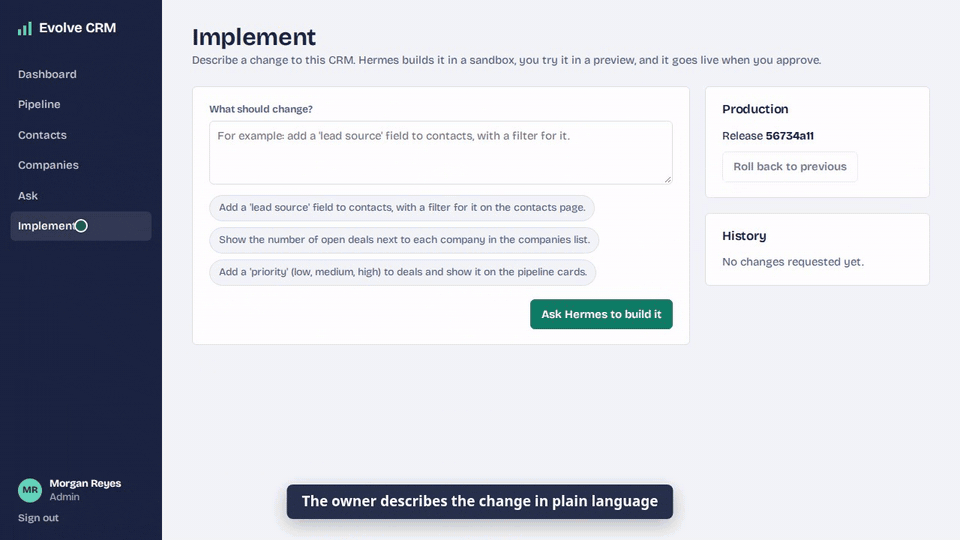
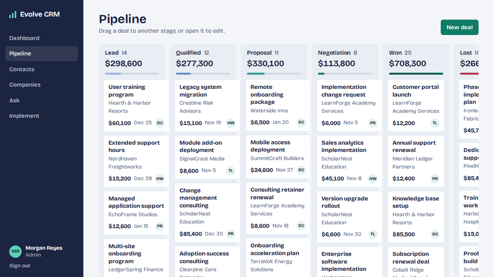
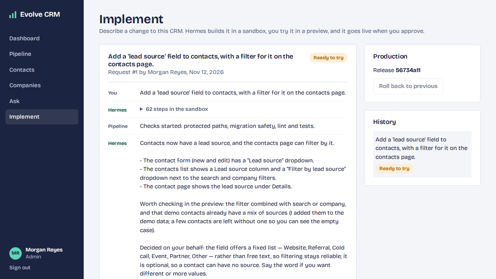
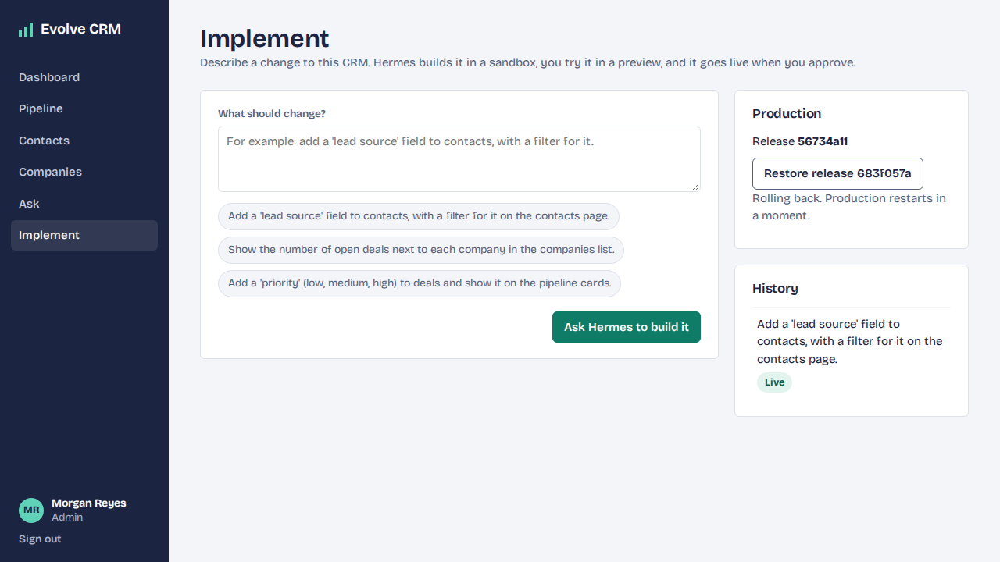
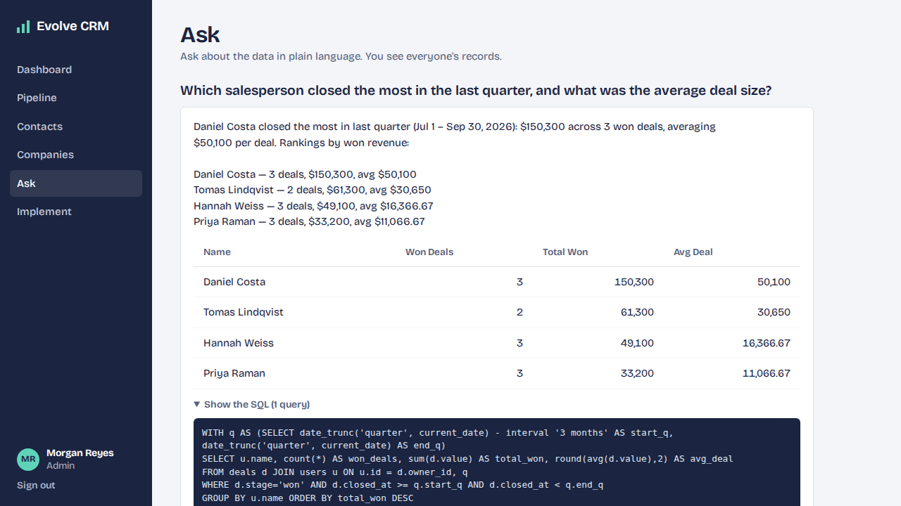
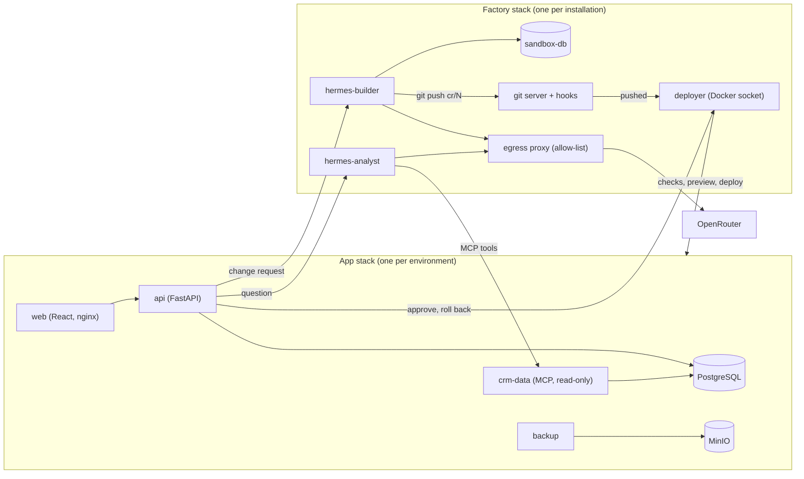

# Evolve CRM

A self-hosted CRM that its owner changes by describing what they need: an AI agent implements the change in a sandbox, the owner tries it in a preview, and a pipeline deploys it to production with one-click rollback.




## What it does

- **A working CRM**: companies, contacts, deals on a pipeline board, activities with tasks and due dates, a dashboard, and two roles (admin and sales).
- **Changes on request**: an admin types "add a lead source field to contacts, with a filter". Hermes, the agent that ships with the product, writes the code, the migration and the tests on a branch.
- **Try before it ships**: every change gets its own preview copy of the app on fictional data. The admin asks for adjustments in the same chat, then approves.
- **Safe delivery**: the pipeline checks every branch (protected files, rollback-safe migrations, lint, tests), backs up the database and the git history before each deploy, smoke tests the release, and rolls back automatically if that fails. Rollback is also one click.
- **Questions about the data**: anyone can ask "who closed the most last quarter?" and get the answer, the rows and the SQL behind it. A sales user only gets their own records, enforced by PostgreSQL row-level security.

Everything runs on one machine with Docker. No GitHub account, runner or cloud service is needed.

## Quick start

The CRM alone, with fictional demo data (about two minutes, no API key):

```bash
git clone https://github.com/joaopaulopresa/evolve-crm.git
cd evolve-crm
docker compose up -d
```

Open <http://localhost:8080> and sign in as `admin@evolve.test` / `admin123` (admin) or `priya@evolve.test` / `demo1234` (sales).

The full product, where the CRM can change itself and answer questions (needs an [OpenRouter](https://openrouter.ai) key, about ten minutes for the first build):

```bash
cp .env.example .env            # put your key in OPENROUTER_API_KEY
./deploy/install.sh             # git server, deployer, agents; deploys production
docker compose -f docker-compose.observability.yml up -d   # optional: Langfuse, Prometheus, Grafana
```

| What | Where |
|---|---|
| Production CRM (Implement and Ask pages work here) | <http://localhost:8100> |
| Preview of change request N | `http://localhost:82NN` |
| Langfuse (`admin@evolve.test` / `admin12345`) | <http://localhost:3300> |
| Grafana | <http://localhost:3301> |

Remove everything again with `./deploy/uninstall.sh --yes`.

## Demos

All four are recorded by scripts in `e2e/demo/` that drive the real application; waiting for the agent and for deploys is sped up, nothing else is edited.

| | |
|---|---|
| [](docs/media/01-tour.mp4) | **Tour** of the CRM: dashboard, pipeline board, a contact's timeline. |
| [](docs/media/02-change-request.mp4) | **Change request**: ask, preview, adjust, approve, live. Ends on the Langfuse trace and the Grafana delivery dashboard. |
| [](docs/media/03-rollback.mp4) | **Rollback**: production goes back one release; the data stays. |
| [](docs/media/04-ask.mp4) | **Ask**: the same question as an admin and as a sales user. |

## Architecture



How a change travels:

1. The admin opens a change request. The API starts a Hermes run with a fresh session.
2. Hermes works on branch `cr/N` in its checkout, runs migrations and tests against the sandbox database, and pushes the branch. It has no Docker access and no route to the internet except the model provider.
3. The git server's hook tells the deployer, which runs `deploy/checks.sh` and starts a preview with its own database.
4. The admin tries the preview. A reply continues the same Hermes session on the same branch.
5. On approval the deployer pushes the commit to `main` through the same git server. The hook only lets `main` fast-forward to a commit that passed the checks and that an admin approved.
6. The deployer backs up, deploys production and smoke tests it, restoring the previous release if the test fails.

All pipeline logic is in `deploy/*.sh`; the deployer only decides which script runs when.

### Guardrails

- The agent that writes code never sees real data, and the agent that reads real data cannot act: they are separate containers on separate networks.
- A branch that touches the pipeline, the agents' own configuration, authentication or secrets is rejected (`deploy/protected-paths.txt`).
- Migrations must leave the previous release working, because rollback runs old code on the new schema (`deploy/check_migrations.py`).
- The data tools run as a database role that can only `SELECT`, one statement per call, with a time limit and a row cap. Who is asking is set by the API, never by the model.
- If the agent's setup fails, its container stops instead of starting with default settings.

## Tech stack

Python 3.13, FastAPI, SQLAlchemy, Alembic, PostgreSQL 16, React 19, TypeScript, Vite, Docker Compose, [Hermes Agent](https://github.com/NousResearch/hermes-agent), the Model Context Protocol, MinIO, Langfuse, Prometheus, Grafana, Playwright.

## Tests

```bash
docker compose up -d
docker compose exec api pytest                 # API, against a real PostgreSQL
npm --prefix web ci && npm --prefix web test   # web
cd e2e && npm ci && npx playwright install chromium && npm test   # end to end
./backup/test_roundtrip.sh                     # backup and restore round trip
```

The pipeline's own checks, the deployer and the data tools have tests in `deploy/tests`, `factory/deployer/tests` and `crm-data/tests`. The API suite replaces Hermes with a fake agent, so it needs no API key.

## Project structure

```
api/            FastAPI app, models, migrations, tests
web/            React app
crm-data/       MCP server with read-only query tools
factory/        git server and hooks, deployer, Hermes image, egress proxy
deploy/         pipeline scripts, environment overrides, install and uninstall
backup/         backup image, backup and restore scripts
observability/  Prometheus config and Grafana dashboards
seed/           fictional dataset and its generator
e2e/            Playwright tests and demo recording scripts
```

## Limits, and what was not tested

- Built and tested on one Linux machine (Docker 29 on WSL2). Not deployed to a public server; previews are `localhost` ports without TLS.
- Only the local delivery mode exists. A GitHub Actions mode and AWS/GCP targets are planned, not built.
- One change request at a time, and questions are answered one at a time.
- A change that needs a new dependency is out of the agent's reach: it has no access to package registries.
- Rollback switches the running release. The change stays in the repository and its columns stay in the database.
- Backups go to MinIO on the same machine. That protects against a bad deploy or a bad migration, not against losing the server; point `S3_ENDPOINT` at external storage for that.
- Answers are written by sending the question, the table layout and the query results to the model provider, and the traces in Langfuse contain them. Switch the feature off with `ASK_ENABLED=false`.
- The agent's output depends on the model. The demos used `deepseek/deepseek-v4.1-flash-1017` through OpenRouter; a request cost about two cents.

## Licence

MIT, see [LICENSE](LICENSE). All demo data is fictional and was generated for this project.
